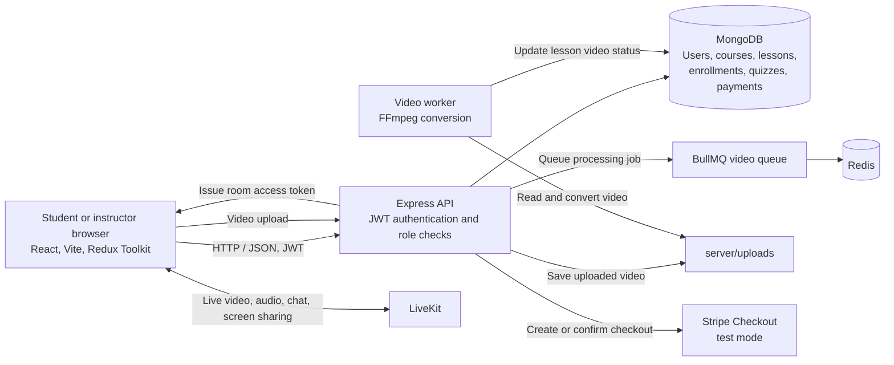

# FS-03 LMS: Architecture and API

## Architecture



The React client calls the Express API. The API stores application data in MongoDB and protects signed-in actions with JWT authentication and role checks. Lesson videos are uploaded to the server, queued through BullMQ and Redis, and processed by an FFmpeg worker. Stripe handles test-mode checkout; LiveKit provides live-class media.

## API

Base URL for local development: `http://localhost:5000`

For protected endpoints, send:

```http
Authorization: Bearer <JWT>
```

### Health and authentication

| Method | Endpoint | Access | Purpose |
|---|---|---|---|
| GET | `/api/health` | Public | Check that the API is running |
| POST | `/api/auth/register` | Public | Create an account |
| POST | `/api/auth/login` | Public | Sign in and receive an access token |
| GET | `/api/auth/me` | Signed in | Get the current account |

### Courses and lessons

| Method | Endpoint | Access | Purpose |
|---|---|---|---|
| GET | `/api/courses` | Public | List published courses |
| GET | `/api/courses/:courseId` | Public | Get published course details |
| POST | `/api/courses` | Instructor or admin | Create a course |
| GET | `/api/courses/mine` | Instructor or admin | List the instructor’s courses |
| PATCH | `/api/courses/:courseId/publish` | Instructor or admin | Publish a course |
| POST | `/api/courses/:courseId/lessons` | Instructor or admin | Add a lesson |
| POST | `/api/courses/:courseId/lessons/:lessonId/video` | Instructor or admin | Upload a lesson video |
| POST | `/api/courses/:courseId/enroll` | Student | Enroll in a course |
| GET | `/api/courses/:courseId/progress` | Student | Get course progress |
| PATCH | `/api/courses/:courseId/lessons/:lessonId/complete` | Student | Mark a lesson complete |

### Quizzes and certificates

| Method | Endpoint | Access | Purpose |
|---|---|---|---|
| GET | `/api/quizzes/:courseId` | Public | List quizzes for a published course |
| POST | `/api/quizzes/:courseId` | Instructor or admin | Create a quiz |
| POST | `/api/quizzes/:courseId/:quizId/submit` | Student | Submit quiz answers |
| POST | `/api/certificates/:courseId` | Student | Request a course certificate |

### Live classes and payments

| Method | Endpoint | Access | Purpose |
|---|---|---|---|
| POST | `/api/live-classes/:courseId/token` | Signed in | Get a LiveKit access token |
| GET | `/api/payments/earnings` | Instructor or admin | View paid-enrollment earnings |
| POST | `/api/payments/:courseId/checkout` | Student | Start Stripe Checkout |
| POST | `/api/payments/confirm` | Student | Confirm a completed checkout |

Protected endpoints require a valid JWT. The server also checks the account role for role-restricted actions. Stripe is configured for test payments.